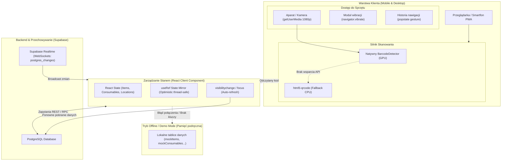

# 🏗️ Architektura Systemu — Eko-Energia PMS

Dokument ten opisuje strukturę techniczną aplikacji, przepływ danych, zarządzanie stanem oraz kluczowe decyzje architektoniczne podjęte w projekcie.

---

## 1. Diagram Architektury Przepływu Danych



---

## 2. Model Komponentów: Client-First Architecture

Wszystkie główne podstrony w katalogu `app/` są oznaczone dyrektywą `'use client'`. 

### Dlaczego Client Components?
Aplikacja jest wysoce interaktywnym narzędziem warsztatowym, które wymaga:
1. Bezpośredniego dostępu do API przeglądarki (`navigator.mediaDevices.getUserMedia`, `window.BarcodeDetector`, `navigator.vibrate`).
2. Ciągłego nasłuchiwania zdarzeń WebSocket przez Supabase Realtime.
3. Obsługi gestów cofania na smartfonach (`window.history.pushState` i nasłuchiwanie `popstate`).
4. Błyskawicznych aktualizacji optymistycznych (kliknięcia `+` / `-` przy pakowaniu bez opóźnień sieciowych).
5. Natychmiastowego przełączania w **Tryb Demo / Offline**, jeśli sieć w warsztacie lub hali zawodów zawiedzie.

---

## 3. System Podwójny: Supabase Live vs Tryb Demo (Mock)

Aplikacja została zaprojektowana tak, aby **nigdy nie zablokować pracy zespołu**, nawet w przypadku braku internetu, braku konfiguracji bazy danych lub podczas prezentacji i testów.

### Jak działa przełącznik trybów?
W każdej podstronie funkcja ładująca dane (`fetchData`) wykonuje zapytanie do Supabase wewnątrz bloku `try / catch`:

```typescript
try {
  setLoading(true);
  const [itemsRes, consRes] = await Promise.all([
    supabase.from('items').select('*'),
    supabase.from('consumables').select('*')
  ]);
  if (itemsRes.error || consRes.error) throw new Error('Błąd bazy');

  setItems(itemsRes.data);
  setIsDemoMode(false);
} catch (err) {
  console.warn('Brak połączenia z bazą, aktywacja trybu DEMO:', err);
  setIsDemoMode(true);
  setItems(mockItems);
  setConsumables(mockConsumables);
} finally {
  setLoading(false);
}
```

### Zasada działania mutacji danych (CRUD):
Każda funkcja dodająca, edytująca lub usuwająca zasób posiada rozgałęzienie:
- **`if (isDemoMode)`**: dane są mutowane lokalnie w stanie Reacta (oraz w kopiach pamięciowych `mockItems`), a użytkownik widzi powiadomienie Toast: *"Zaktualizowano stan (Tryb Demo)"*.
- **`else`**: dane są wysyłane do Supabase (`supabase.from(...).update(...)`). Jeśli zapytanie się nie powiedzie, stan optymistyczny jest wycofywany.

---

## 4. Architektura Czasu Rzeczywistego (Realtime & Auto-Revalidate)

W warsztacie i podczas zawodów z aplikacji korzysta jednocześnie wiele osób z różnych telefonów i laptopów. Wyeliminowano problem nieaktualnych danych (*Stale Data*) za pomocą dwustopniowego mechanizmu:

### A. Subskrypcje Supabase Realtime (WebSockets)
Komponenty subskrybują zmiany tabel PostgreSQL (`items`, `consumables`, `locations`, `categories`, `events`, `event_consumables`):

```typescript
const channel = supabase
  .channel('magazyn-changes')
  .on('postgres_changes', { event: '*', schema: 'public', table: 'items' }, () => {
    fetchData();
  })
  .on('postgres_changes', { event: '*', schema: 'public', table: 'consumables' }, () => {
    fetchData();
  })
  .subscribe();

return () => {
  supabase.removeChannel(channel);
};
```

### B. Auto-odświeżanie przy powrocie do karty (`visibilitychange` / `focus`)
Smartfony często usypiają połączenia WebSocket, gdy ekran jest zablokowany lub użytkownik przełącza aplikacje. Dlatego każda podstrona nasłuchuje zdarzeń aktywności okna:

```typescript
const handleFocus = () => {
  if (document.visibilityState === 'visible') {
    fetchData();
  }
};

window.addEventListener('visibilitychange', handleFocus);
window.addEventListener('focus', handleFocus);
```

### C. Bezpieczne optymistyczne aktualizacje (`useRef` Sync)
Przy szybkim klikaniu przycisków `+` / `-` w materiałach zużywalnych, asynchroniczny stan Reacta mógłby doprowadzić do nadpisania danych (race conditions). Zastosowano wzorzec lustrzanego stanu w referencji:

```typescript
const consumablesRef = useRef<DatabaseConsumable[]>([]);
useEffect(() => {
  consumablesRef.current = consumables;
}, [consumables]);

// Podczas kliknięcia:
// 1. Natychmiast modyfikujemy consumablesRef.current
// 2. Wywołujemy setConsumables(consumablesRef.current)
// 3. Wysyłamy zapytanie do Supabase w tle
```

---

## 5. Mobilne Wzorce UX (Mobile-First Polish)

Aplikacja ma zachowywać się jak natywna aplikacja na iOS i Androidzie:

1. **Przechwytywanie gestu "Wstecz" (Popstate Interceptor)**:  
   Gdy użytkownik otwiera modal (edycja przedmiotu, skaner, zarządzanie kategoriami), komponent dodaje wpis do historii przeglądarki:
   ```typescript
   window.history.pushState({ modalOpen: true }, '', window.location.href);
   ```
   Gdy użytkownik wykona gest cofnięcia lub kliknie fizyczny przycisk "Wstecz" w telefonie, zdarzenie `popstate` zamyka otwarty modal, zamiast cofać użytkownika do poprzedniej podstrony.

2. **Blokada przewijania tła (Body Scroll Lock)**:  
   Otwarcie jakiegokolwiek modala natychmiast blokuje przewijanie strony pod spodem (`document.body.style.overflow = 'hidden'`). Zamknięcie modala przywraca poprzednią wartość.

3. **Haptyka (Web Vibration API)**:  
   Pomyślne odczytanie kodu kreskowego lub kodu QR wywołuje krótką wibrację telefonu (`navigator.vibrate(100)`), dając natychmiastową informację zwrotną w głośnym warsztacie.

4. **Powiadomienia Toast i mikrointerakcje**:  
   Zmienione wiersze tabeli otrzymują chwilowe podświetlenie ramki/tła (`recentlyUpdatedId`), a w rogu ekranu pojawia się dyskretny Toast znoszący potrzebę uciążliwych `alert()`.
