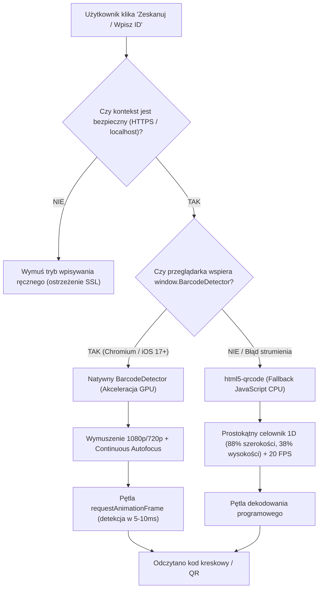

# 📷 Skaner Kodów Kreskowych i QR — Eko-Energia PMS

Dokument ten opisuje architekturę skanera, optymalizacje sprzętowe, obsługę fizycznych naklejek 1D i 2D, rozwiązanie problemu fałszywych odczytów (*False Positives*) oraz specyfikę cyklu życia kamery na smartfonach.

---

## 1. Wyzwania Skanowania w Warunkach Warsztatowych

W warsztacie koła naukowego i na wyjazdach skanowanie odbywa się w niesprzyjających warunkach:
- **Odblaski i zarysowania**: kody naklejone na metalowych narzędziach, śliskich tworzywach i zaolejonych powierzchniach.
- **Odległość i słabe światło**: konieczność łapania ostrości z odległości 10–30 cm przy sztucznym świetle jarzeniówek.
- **Kody 1D (Code 128)**: wąskie kreski o zmiennej gęstości, wymagające wyższej rozdzielczości niż kontrastowe kody QR.

---

## 2. Podwójny Silnik Skanowania (Dual-Engine Pipeline)

Głównym komponentem skanera jest [`app/components/ScannerButton.tsx`](../app/components/ScannerButton.tsx). Implementuje on strategię dwupoziomową:



### A. Silnik Podstawowy: Natywny `window.BarcodeDetector` (Hardware GPU)
- Dostępny w Chrome/Edge (Android i Desktop) oraz nowszych wersjach Safari (iOS 17+).
- Dekodowanie klatek wideo odbywa się bezpośrednio na poziomie procesora graficznego (GPU), bez narzutu interpretera JavaScript.
- Czas odczytu: **5–10 ms na klatkę**. Radzi sobie z poruszeniem i odblaskami.

### B. Silnik Zapasowy: `html5-qrcode` (Fallback)
- Uruchamiany automatycznie, jeśli `BarcodeDetector` nie jest wspierany lub zgłosi wyjątek.
- Zoptymalizowany pod kody 1D:
  - Częstotliwość próbkowania: `fps: 20`.
  - Geometria celownika (`qrbox`): dynamiczny prostokąt dopasowany do kodów paskowych:
    ```javascript
    qrbox: (viewfinderWidth, viewfinderHeight) => ({
      width: Math.floor(viewfinderWidth * 0.88),
      height: Math.floor(viewfinderHeight * 0.38)
    })
    ```

---

## 3. 🚨 Rygorystyczna Biała Lista Formatów (Ochrona przed Partial Read / False Positive)

### Historia Problemu:
Gdy skaner miał włączoną obsługę wielu formatów (np. `ean_13`, `code_39`, `ean_8`, `itf`), fizyczny kod **Code 128** o wartości `2137420000000` był na telefonach regularnie błędnie odczytywany jako losowy 8-cyfrowy ciąg (np. `15977542`).  
**Przyczyna**: Podczas poruszania aparatem celownik obejmował tylko środkowy fragment kresek. Algorytmy formatów ITF lub EAN-8 interpretowały ten wycinek jako poprawny kod o innej strukturze.

### Wdrożone Rozwiązanie:
Zablokowano wszystkie formaty krótkie i dopuszczono **WYŁĄCZNIE DWA FORMATY**:

1. **W natywnym `BarcodeDetector`**:
   ```typescript
   const detector = new (window as any).BarcodeDetector({
     formats: ['code_128', 'qr_code']
   });
   ```

2. **W silniku `html5-qrcode`**:
   ```typescript
   const supportedFormats = [
     Html5QrcodeSupportedFormats.CODE_128,
     Html5QrcodeSupportedFormats.QR_CODE
   ];
   ```

> ⚠️ **ZASADA DLA AI**: Pod żadnym pozorem nie dodawaj `EAN-8`, `ITF`, `UPC-E` ani `CODE-39` do powyższych list. Spowoduje to natychmiastowy powrót problemu fałszywych odczytów w warsztacie!

---

## 4. Cykl Życia Kamery na Smartfonach (Mobile Camera Lifecycle Fix)

### Historia Problemu:
Na mobilnym Chrome i Safari natychmiastowe zatrzymanie kamery (`scanner.stop()`) po odczytaniu kodu powodowało:
1. Zniknięcie paska adresu przeglądarki i skok wysokości okna (`vh resize`).
2. Utratę fokusu (`blur`).
3. Zresetowanie stanu nadrzędnego komponentu Reacta, co natychmiast **zamykało modal edycji przedmiotu**, zanim użytkownik zdążył cokolwiek zapisać.

### Architektura Bezpiecznego Zamykania Kamery:
Zastosowano 4-etapową sekwencję w funkcji `handleSuccess`:

```typescript
const handleSuccess = (rawText: string) => {
  if (!isScanningActive) return;
  const parsedCode = parseCodeFromInput(rawText);
  if (parsedCode) {
    isScanningActive = false;
    const cleanCode = String(parsedCode).trim();

    // 1. Haptyka (wibracja)
    if (typeof window !== 'undefined' && 'vibrate' in navigator) {
      navigator.vibrate(100);
    }

    // 2. Natychmiastowe WSTRZYMANIE skanowania (zamrożenie klatki wideo)
    if (html5QrCode && html5QrCode.isScanning) {
      try { html5QrCode.pause(); } catch (e) {}
    }

    // 3. Wywołanie callbacku onScan i zamknięcie TYLKO nakładki skanera
    onScan(cleanCode);
    setIsOpen(false);

    // 4. Pełne zwolnienie zasobów kamery asynchronicznie w tle
    setTimeout(() => {
      if (animFrameId) cancelAnimationFrame(animFrameId);
      if (mediaStream) {
        mediaStream.getTracks().forEach(t => t.stop());
        mediaStream = null;
      }
      if (html5QrCode && html5QrCode.isScanning) {
        html5QrCode.stop().catch(() => {});
      }
      resetModal();
    }, 300);
  }
};
```

---

## 5. Bezpośrednia Synchronizacja DOM (DOM Input Sync Safeguard)

Na niektórych starszych urządzeniach z systemem iOS/Android asynchroniczny stan Reacta potrafił zagubić wartość kodu w formularzu. W modalu edycji [`app/components/ItemEditModal.tsx`](../app/components/ItemEditModal.tsx) zastosowano dwustopniowe przypisanie:

```typescript
<ScannerButton
  buttonText=""
  icon={Barcode}
  onScan={(scannedCode) => {
    if (scannedCode) {
      const cleanCode = String(scannedCode).trim();
      
      // 1. Aktualizacja reaktywnego stanu Reacta
      setItemBarcode(cleanCode);
      
      // 2. Bezpośrednie wymuszenie wartości w węźle DOM jako zabezpieczenie
      setTimeout(() => {
        const input = document.getElementById('barcode-input') as HTMLInputElement;
        if (input) {
          input.value = cleanCode;
          input.dispatchEvent(new Event('input', { bubbles: true }));
        }
      }, 50);
    }
  }}
/>
```

---

## 6. Parsowanie Wejścia (`parseCodeFromInput`)

Użytkownicy mogą skanować zarówno fizyczne naklejki z czystym kodem, jak i wygenerowane wcześniej kody QR zawierające pełne adresy URL. Funkcja `parseCodeFromInput`:
- Jeśli zeskanowany tekst zaczyna się od `http://` lub `https://`, parsuje go jako URL i wyciąga parametr `?id=...` (np. `https://eko-energia.pl/skan?id=I-NR-0001` $\rightarrow$ `I-NR-0001`).
- W przeciwnym razie zwraca surowy, oczyszczony z białych znaków ciąg tekstowy (np. `00045` lub `2137420000000`).
