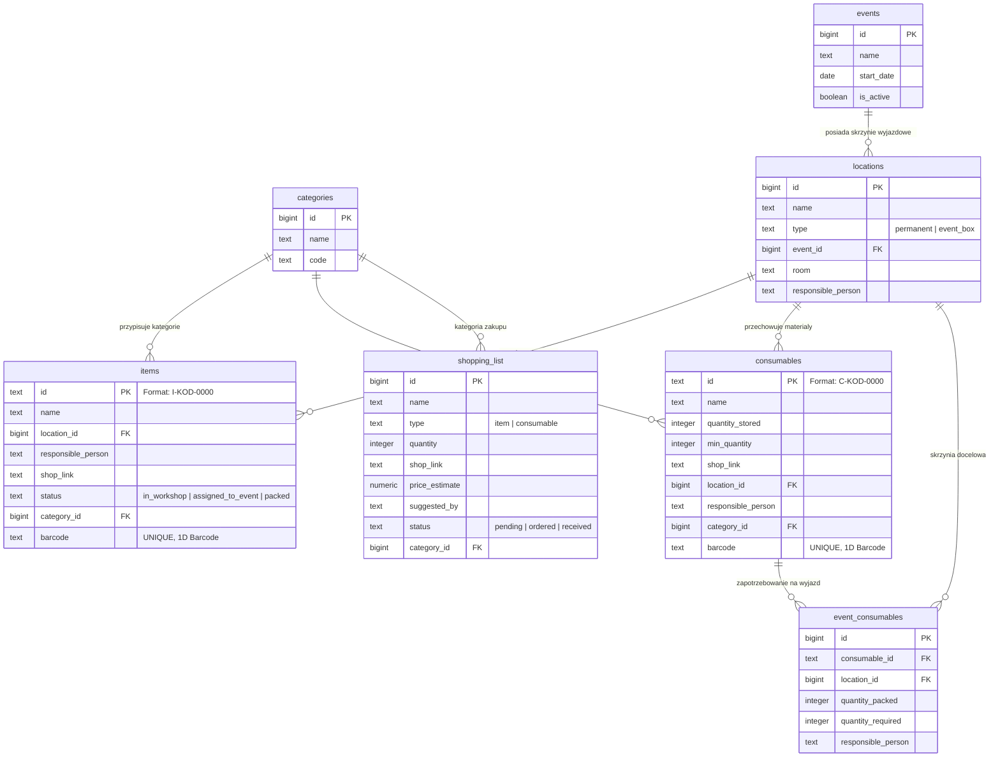

# 🗄️ Schemat Bazy Danych i Model Danych — Eko-Energia PMS

Dokument zawiera kompletną specyfikację bazy danych PostgreSQL (Supabase), relacje encji, reguły nazewnictwa identyfikatorów SKU, kody kreskowe oraz gotowy skrypt DDL.

---

## 1. Diagram Relacji Encji (ERD)



---

## 2. Gotowy Skrypt SQL (DDL) dla Supabase

Poniższy skrypt można uruchomić bezpośrednio w konsoli **Supabase SQL Editor**, aby odtworzyć strukturę bazy danych od zera:

```sql
-- 1. TABELA KATEGORII
CREATE TABLE IF NOT EXISTS public.categories (
    id BIGSERIAL PRIMARY KEY,
    name TEXT NOT NULL,
    code TEXT NOT NULL UNIQUE
);

-- Wstawienie domyślnej kategorii "Bez kategorii" (BK)
INSERT INTO public.categories (name, code)
VALUES ('Bez kategorii', 'BK')
ON CONFLICT (code) DO NOTHING;

-- 2. TABELA WYDARZEŃ / ZAWODÓW
CREATE TABLE IF NOT EXISTS public.events (
    id BIGSERIAL PRIMARY KEY,
    name TEXT NOT NULL,
    start_date DATE NOT NULL DEFAULT CURRENT_DATE,
    is_active BOOLEAN NOT NULL DEFAULT true
);

-- 3. TABELA LOKALIZACJI I SKRZYŃ
CREATE TABLE IF NOT EXISTS public.locations (
    id BIGSERIAL PRIMARY KEY,
    name TEXT NOT NULL,
    type TEXT NOT NULL CHECK (type IN ('permanent', 'event_box')),
    event_id BIGINT REFERENCES public.events(id) ON DELETE CASCADE,
    room TEXT,
    responsible_person TEXT
);

-- 4. TABELA SPRZĘTU TRWAŁEGO (ITEMS)
CREATE TABLE IF NOT EXISTS public.items (
    id TEXT PRIMARY KEY, -- SKU format: I-KOD-0000
    name TEXT NOT NULL,
    location_id BIGINT REFERENCES public.locations(id) ON DELETE SET NULL,
    responsible_person TEXT,
    shop_link TEXT,
    status TEXT NOT NULL DEFAULT 'in_workshop' CHECK (status IN ('in_workshop', 'assigned_to_event', 'packed')),
    category_id BIGINT REFERENCES public.categories(id) ON DELETE SET NULL,
    barcode TEXT UNIQUE
);

-- 5. TABELA MATERIAŁÓW ZUŻYWALNYCH (CONSUMABLES)
CREATE TABLE IF NOT EXISTS public.consumables (
    id TEXT PRIMARY KEY, -- SKU format: C-KOD-0000
    name TEXT NOT NULL,
    quantity_stored INTEGER NOT NULL DEFAULT 0 CHECK (quantity_stored >= 0),
    min_quantity INTEGER NOT NULL DEFAULT 0 CHECK (min_quantity >= 0),
    shop_link TEXT,
    location_id BIGINT REFERENCES public.locations(id) ON DELETE SET NULL,
    responsible_person TEXT,
    category_id BIGINT REFERENCES public.categories(id) ON DELETE SET NULL,
    barcode TEXT UNIQUE
);

-- 6. TABELA ZAPOTRZEBOWANIA NA ZAWODY (EVENT_CONSUMABLES)
CREATE TABLE IF NOT EXISTS public.event_consumables (
    id BIGSERIAL PRIMARY KEY,
    consumable_id TEXT NOT NULL REFERENCES public.consumables(id) ON DELETE CASCADE,
    location_id BIGINT NOT NULL REFERENCES public.locations(id) ON DELETE CASCADE,
    quantity_packed INTEGER NOT NULL DEFAULT 0 CHECK (quantity_packed >= 0),
    quantity_required INTEGER NOT NULL DEFAULT 1 CHECK (quantity_required >= 0),
    responsible_person TEXT
);

-- 7. TABELA LISTY ZAKUPÓW (SHOPPING_LIST)
CREATE TABLE IF NOT EXISTS public.shopping_list (
    id BIGSERIAL PRIMARY KEY,
    name TEXT NOT NULL,
    type TEXT NOT NULL CHECK (type IN ('item', 'consumable')),
    quantity INTEGER NOT NULL DEFAULT 1 CHECK (quantity > 0),
    shop_link TEXT,
    price_estimate NUMERIC(10,2),
    suggested_by TEXT,
    status TEXT NOT NULL DEFAULT 'pending' CHECK (status IN ('pending', 'ordered', 'received')),
    category_id BIGINT REFERENCES public.categories(id) ON DELETE SET NULL
);

-- 8. WŁĄCZENIE REPLIKACJI REALTIME
ALTER PUBLICATION supabase_realtime ADD TABLE public.categories;
ALTER PUBLICATION supabase_realtime ADD TABLE public.events;
ALTER PUBLICATION supabase_realtime ADD TABLE public.locations;
ALTER PUBLICATION supabase_realtime ADD TABLE public.items;
ALTER PUBLICATION supabase_realtime ADD TABLE public.consumables;
ALTER PUBLICATION supabase_realtime ADD TABLE public.event_consumables;
ALTER PUBLICATION supabase_realtime ADD TABLE public.shopping_list;

-- 9. INDEKSY DLA SZYBKIEGO WYSZUKIWANIA BARCODE / SKU
CREATE INDEX IF NOT EXISTS idx_items_barcode ON public.items(barcode);
CREATE INDEX IF NOT EXISTS idx_consumables_barcode ON public.consumables(barcode);
```

---

## 3. Konwencja Identyfikatorów SKU (`id`)

Klucze główne tabel `items` oraz `consumables` nie są liczbami całkowitymi ani UUID, lecz **czytelnymi ciągami znaków SKU**:

```text
[Typ]-[KodKategorii]-[NumerKolejny]
```

- **Typ**:
  - `I` (*Item*) – sprzęt trwały (np. wkrętarka, mikroskop, zasilacz).
  - `C` (*Consumable*) – materiał zużywalny (np. śruby, cyna, taśma).
- **KodKategorii**:
  - Dwuliterowy lub trzyliterowy kod pobierany z tabeli `categories.code` (np. `NR` = Narzędzia ręczne, `EL` = Elektronika, `BK` = Bez kategorii).
- **NumerKolejny**:
  - 4-cyfrowa liczba dopełniana zerami (`0001`, `0002`, ..., `9999`).

### Algorytm sugerowania kolejnego SKU (`suggestNextSku`):
Przeszukuje istniejące identyfikatory o danym prefiksie (np. `I-NR-`), wyciąga najwyższy istniejący numer i inkrementuje go o 1:
```typescript
const suggestNextSku = async (type: 'I' | 'C', categoryId: number | null): Promise<string> => {
  if (!categoryId) return '';
  const cat = categories.find(c => c.id === categoryId);
  if (!cat || !cat.code) return '';
  const prefix = `${type}-${cat.code.toUpperCase()}-`;
  
  // Znajduje najwyższy numer w tabeli i formatuje np. I-NR-0005
  // ...
};
```

---

## 4. Obsługa Kodów Kreskowych (`barcode`)

Do tabel `items` oraz `consumables` wprowadzono kolumnę `barcode (TEXT, UNIQUE)`.
- Służy do powiązania fizycznych naklejek z kodami kreskowymi 1D (np. Code 128, naklejki z numerami `00045`, `2137420000000`, `5901234567890`) z rekordem w bazie.
- **Logika wyszukiwania**: Skaner w aplikacji szuka rekordu jednocześnie po `barcode` oraz po pierwotnym kluczu `id` (SKU):
  ```typescript
  const { data: item } = await supabase
    .from('items')
    .select('*, locations(type, event_id)')
    .or(`barcode.eq.${searchCode},id.eq.${searchCode}`)
    .maybeSingle();
  ```
- Jeśli przedmiot nie zostanie znaleziony w `items`, przeszukiwana jest analogicznie tabela `consumables`.

---

## 5. Kategoria Specjalna: "Bez kategorii" (`BK`)

- W bazie danych istnieje dedykowany rekord: `{ id: ..., name: 'Bez kategorii', code: 'BK' }`.
- **Domyślny wybór**: Podczas tworzenia nowego przedmiotu trwałego lub materiału, kategoria ta jest wybierana automatycznie, dzięki czemu użytkownik może dodać sprzęt od ręki bez wymuszonego kategoryzowania.
- **Wyświetlanie na liście**: Jeśli przedmiot posiada kategorię `BK` (lub `category_id = null`), etykieta kategorii **nie jest wyświetlana** na liście w magazynie (aby nie zaśmiecać widoku).
- **Filtrowanie**: W filtrze kategorii opcja "Bez kategorii" dopasowuje zarówno przedmioty z przypisanym ID tej kategorii, jak i przedmioty z `category_id = null`.
